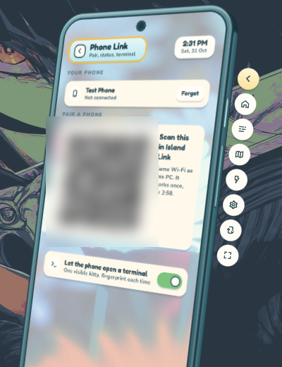

# island-link-pc

PC side of **Island Link**: a small Go helper that links the Island shell (Hyprland, CachyOS) to the phone app
[island-link-android](https://github.com/minhtriet199/island-link-android).

- Pairing by one-time QR, then one encrypted connection (TLS 1.3, pinned certificate) to the phone
- Phone notifications → normal desktop notifications (Island bubbles)
- Download mode: live progress on the phone, plus start, stop and "what happens after" from it
- Controls: music, volume, brightness, lock, sleep, restart, shut down (these go through Island)
- Remote: touchpad and keyboard through a virtual `/dev/uinput` device that exists only while the screen is open
- Clipboard both ways, files from the phone into `~/Downloads/Island Link`
- Terminal: one visible kitty window, mirrored on the phone. Off until you allow it in Island, fingerprint on every open

Light in the background (about 12 MB, no timers while idle); Island is the UI, under Settings → Phone Link.
Same Wi-Fi only for now.

## In Island

<p>
  
</p>

While the phone has a terminal open, the top bar shows this. Click it to close the window:


## Install

```sh
go build -o island-link-pc .
install -m 755 island-link-pc ~/.local/bin/island-link-pc
cp contrib/island-link.service ~/.config/systemd/user/
systemctl --user daemon-reload
systemctl --user enable --now island-link.service
```

Open TCP port 47800 in your firewall. Needs `qrencode`, `playerctl`, `wl-clipboard`, `wireplumber`, `brightnessctl`, `kitty`.
Accented text in Remote also needs `wtype`.

## Testing with Island

Everything Island is subscribed to reacts to the phone, so a test helper must never share the real one's `ctl.sock`
or data folder: give it its own `XDG_RUNTIME_DIR` and `XDG_DATA_HOME`.
